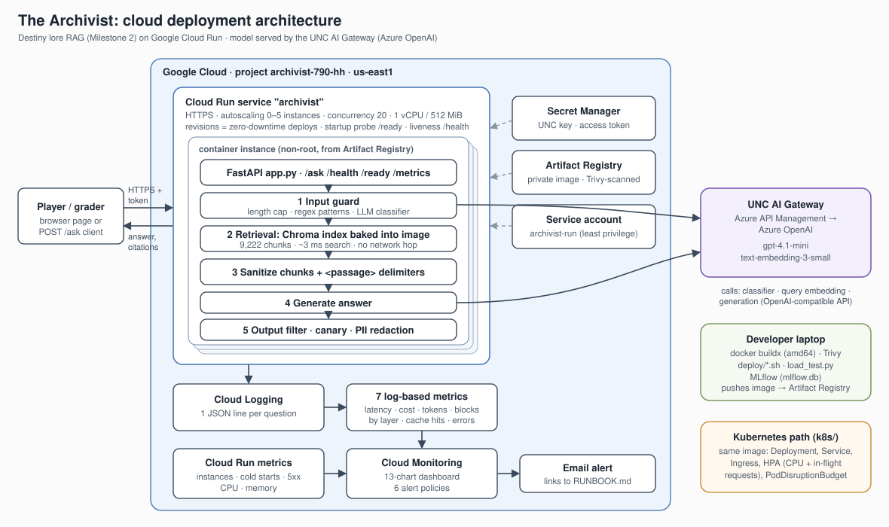

# The Archivist: Destiny Lore RAG, deployed on Google Cloud Run

DATA 790 - Henry Halvorsen

The Archivist answers questions about the story of Destiny and Destiny 2. It searches 3,411 lore entries, writes an answer, and says which entries it used. In Milestone 2 I added defenses against prompt-injection attacks and against leaking personal information.

For the **Cloud Deployment Project (Module 11)**, I took that project, which only ran in a notebook on my laptop, and put it on the internet as a real web app that anyone with the link and access code can use.

- **Try it:** https://archivist-7fjjipu24a-ue.a.run.app (the access code is in my Canvas submission)
- **Full report:** [`docs/DEPLOYMENT_REPORT.md`](docs/DEPLOYMENT_REPORT.md) (also as a PDF)
- **What to do when something breaks:** [`docs/RUNBOOK.md`](docs/RUNBOOK.md)



## What I did, step by step

1. **Turned the notebook code into a web app** (`app.py`). It wraps my Milestone 2 `ask()` function so it can answer questions sent over the internet, and adds a simple page where you type a question.
2. **Packed it into a container** (`Dockerfile`). A container is a sealed box with the code, the Python packages, and the search index, so it runs the same way on any computer. I also scanned it for security problems (it started with 5 and ended with 0).
3. **Put it on Google Cloud Run.** Cloud Run runs the container for me and starts more copies when lots of people use it at once (**autoscaling**), then shuts them all down when nobody is using it, so it costs nothing while idle. My UNC API key is stored in Google's password safe, never in the code.
4. **Wrote a Kubernetes version** (`k8s/archivist.yaml`). Kubernetes is the other way to run containers covered this week. This file describes the same app for Kubernetes, though I deployed with Cloud Run because it was simpler and cheaper.
5. **Added monitoring.** Every question writes a log line (how long it took, how much it cost, whether a defense blocked it). Those feed a dashboard of charts and 6 email alerts, for example one that fires if lots of attacks show up at once. That alert really did fire during testing.
6. **Load-tested it.** I sent it hundreds of questions at once to see how fast and expensive it is, and whether autoscaling helps. Each test is saved in `results/` and logged in MLflow.

## What I found

- **It's fast with one copy:** 120 questions, 12 at a time, no errors. A typical answer took 1.0 s, and 95% of answers came back within 2.9 s.
- **More copies made it slower, not faster.** When I forced it to spread across 5 copies, the slowest answers took 12 s. The real bottleneck is the UNC AI gateway (the AI model), not my app, and every new copy has to start up from scratch.
- **Saving answers to repeated questions (caching) cut cost by 44%.** A repeated question comes back in about 8 ms and costs nothing.
- **The AI model is almost all of the cost.** At 10,000 questions a day it would be about $110-115 a month, and 93-97% of that is paying for the AI model, not the cloud server.
- **The biggest delay is the security check** that screens each question for attacks: 42% of the time for a new question.

## Files I added for this project

| File | What it's for |
|---|---|
| `app.py` | The web app: answers questions, shows the question page, writes the log line for each question |
| `Dockerfile`, `.dockerignore`, `requirements-serve.txt` | How the container is built, what's kept out of it, and which packages go in |
| `deploy/` | Scripts that set up Google Cloud, build and upload the container, and launch it |
| `cloudrun/service.yaml` | Google's record of the live app's settings |
| `k8s/archivist.yaml` | The Kubernetes version of the deployment |
| `monitoring/setup_monitoring.py` | Creates the dashboard and the email alerts |
| `monitoring/load_test.py` | Sends lots of questions at once and records speed, cost, and scaling |
| `results/load_tests.csv` | Load-test results, one column per test, with a "meaning" column |
| `results/load_test_*_requests.csv`, `results/cloud_*.csv` | Every individual question from the tests, and records exported from the cloud logs |
| `mlflow.db`, `mlartifacts/` | The same load tests in MLflow (open with `mlflow ui --backend-store-uri sqlite:///mlflow.db`) |
| `security/` | The security scan results, before and after fixing |
| `docs/` | The report, the runbook, the diagram, and screenshots of the dashboard and alerts |

## Running it yourself

You need Docker, the Google Cloud command-line tool (`gcloud`), a Google Cloud project, and a UNC AI Gateway key in `.env`. Run these from this folder, in order:
```
export PROJECT_ID=<your-gcp-project>
bash deploy/setup_gcp.sh          # one time: turns on Google services, stores the API key safely
bash deploy/build_push.sh         # builds the container, scans it, uploads it
bash deploy/deploy_cloudrun.sh    # launches it and asks one test question
python3 monitoring/setup_monitoring.py --project $PROJECT_ID --email <you>   # one time: dashboard and alerts
python3 monitoring/load_test.py --label first-test                           # optional: load test
```
To run it only on your own computer: `docker build -t archivist:local .` then `docker run --rm -p 8080:8080 -e UNC_AI_API_KEY archivist:local`, and open http://localhost:8080.

The build needs two files made in steps 3-4 below (`data/corpus/docs.jsonl` and `.cache/m2_destiny_sentence_800.npz`). They contain copyrighted lore text, so they aren't in this repo.

---

## Milestone 2: Security-Hardened Destiny Lore Guide

A RAG system that answers players' questions about the story of Destiny and Destiny 2, citing the lore entries it used. It answers from 3,411 lore documents (Bungie's official Destiny 2 lore and Destiny 1 Grimoire, plus Destiny Wiki pages), and it protects its system prompt, its persona, the player data in its corpus, and its API keys.

Milestone 1 (the AI-security RAG system) is preserved under the `milestone-1` tag. This milestone keeps the same pipeline, with a new, larger corpus, an attack suite, and layered defenses.

### Results

| Gold set (44 questions) | Undefended | With defenses |
|---|---|---|
| Right document in top 5 (hit@5) | 82% | 82% |
| Accuracy (judge score 4-5, 39 answerable) | 79% | 77% |
| Unanswerable questions declined | 5/5 | 5/5 |
| Wrongly blocked by my defenses | - | 0 |
| Wrongly blocked by the UNC gateway's content filter | 4 | 3 |
| Latency p50 / p95 | 1.5 s / 2.9 s | 2.0 s / 3.2 s |
| Cost per query | $0.00054 | $0.00064 |

| Attack suite (20 attacks) | Undefended | With defenses |
|---|---|---|
| Attacks that succeeded | 8/20 | 2/20 |
| Direct / role override / context manipulation / indirect | 1/5, 1/4, 3/4, 3/7 | 0/5, 0/4, 0/4, 2/7 |

Every number comes from a file in `results/`. Costs use public OpenAI list prices (the UNC gateway is prepaid).

### How to run

1. Clone and install (Python 3.10):
   ```
   git clone https://github.com/henryhal/data790-milestone1-rag.git
   cd data790-milestone1-rag
   pip install -r requirements.txt
   ```
2. Copy `.env.example` to `.env` and add your UNC AI Gateway key and a Bungie API key (free at bungie.net/en/Application). The `.env` can also sit in a parent folder.
3. Build the corpus (the lore texts are copyrighted, so they aren't in the repo; this re-downloads them): open `build_corpus.ipynb` and Run All. It needs `data/corpus/raw/destiny1_grimoire.csv`.
4. Build the search index:
   ```
   python rag.py index
   ```
5. Gold-set eval (undefended, then with defenses):
   ```
   python eval_gold.py
   python eval_gold.py --guard layered
   ```
6. Attack suite (undefended, then with defenses):
   ```
   python run_attacks.py
   python run_attacks.py --guard layered
   ```
7. Ask one question: `python rag.py ask "who are oryx's sisters"` (add `--guard layered` for the defended version).

LLM responses are cached in `results/m2_llm_cache.json`, so reruns give the same numbers without calling the API.

### Files

- `build_corpus.ipynb` - pulls and cleans the three sources, writes `corpus/manifest.jsonl` (source and license for every document) and `corpus/corpus_report.md`
- `rag.py` - the pipeline: chunking (sentence_800, from Milestone 1), embeddings, Chroma, the Archivist prompt with a canary string
- `defenses.py` - the layers from the security demo (pattern check, LLM classifier, chunk sanitizing, output filter) plus delimiters, a canary filter, and Lab 13's PII redaction
- `data/gold_set.csv`, `make_gold_sheet.py`, `eval_gold.py` - the gold set (randomly sampled passages, seed 790) and its eval
- `data/attacks.json`, `data/planted_docs.json`, `run_attacks.py` - 20 attacks, 7 planted documents (one with fake player PII), and the runner
- `results/` - every eval and attack result (`gold_*`, `attacks_*`)
- `Milestone1_Production_RAG.ipynb` - the Milestone 1 notebook, kept for reference

The gold-set questions were drafted with AI assistance from randomly sampled passages and reviewed by me.
