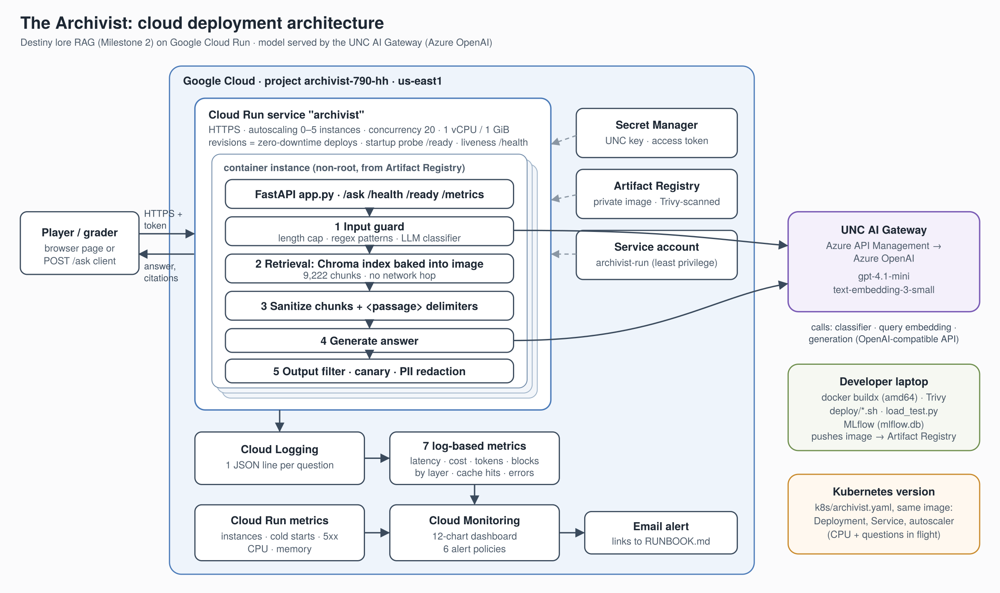
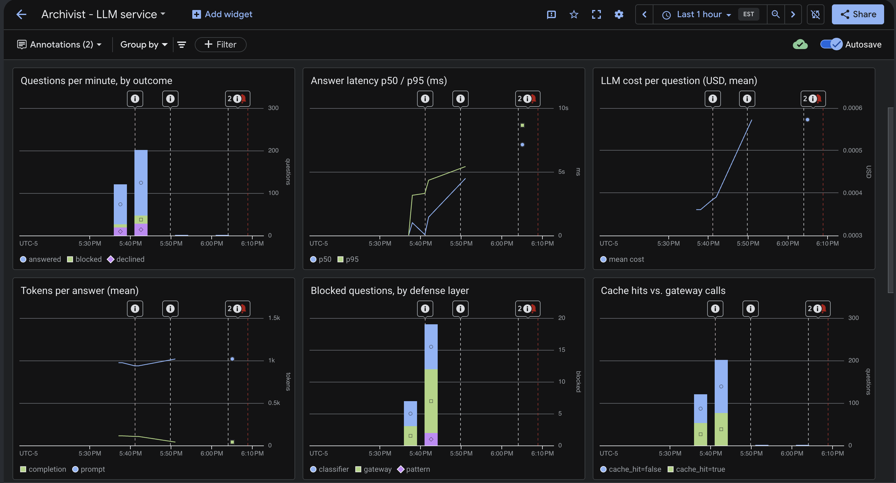
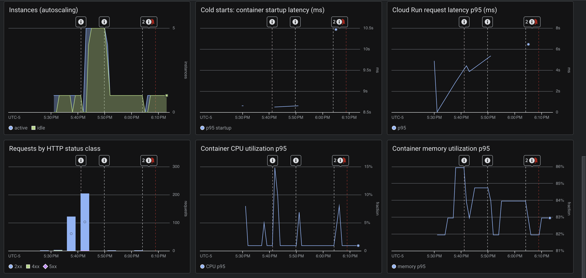
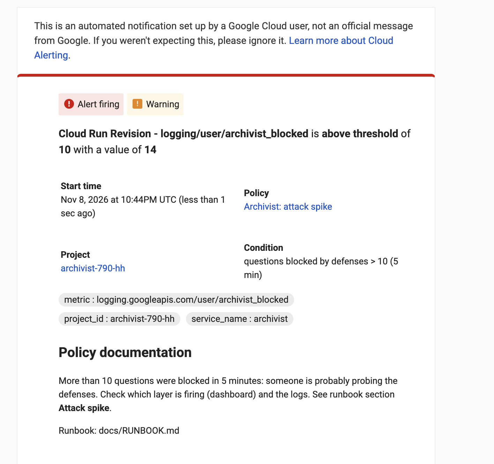
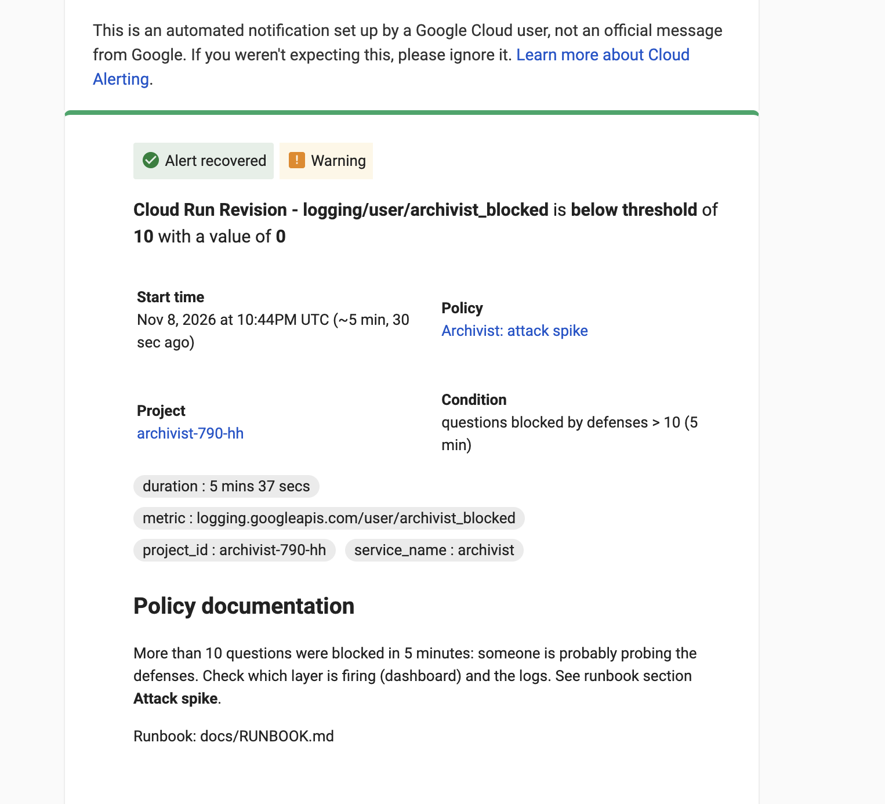

# Cloud Deployment Report: The Archivist on Google Cloud Run

DATA 790, Cloud Deployment Project

Henry Halvorsen, November 2026

Live app: https://archivist-7fjjipu24a-ue.a.run.app (the access code is in the Canvas submission)

Code: https://github.com/henryhal/data790-milestone1-rag (tag `cloud-deployment`; the Milestone 2 version is saved under tag `milestone-2`)

The Archivist is my Milestone 2 project: it answers questions about Destiny's story by searching 3,411 lore entries (split into 9,222 chunks), and it has five layers of defense against attacks. Until this project it only ran on my laptop. For this project I turned it into a web app on Google Cloud that starts extra copies of itself when it gets busy, watches its own health, sends email alerts, and has a measured cost. Section 9 lists where every number in this report comes from.

---

## 1. Summary

| What | Result |
|---|---|
| Where it runs | Google Cloud Run (us-east1), 0 to 5 copies, up to 20 questions per copy at once, 1 CPU and 1 GiB of memory per copy |
| Test A: 120 questions, 12 at a time | No errors. A typical answer (p50) took 1.0 s; 95% of answers (p95) came back within 2.9 s; about 9.1 questions per second; all on 1 copy |
| Test B: 200 questions, 24 at a time, max 4 per copy | Cloud Run grew to 5 copies, but the slowest 5% of answers took 12.0 s or more, and 1 question failed when every copy was full |
| A new question vs. a repeated one (from the cloud logs, 147 new answers) | A new answer took 2.4 s and cost $0.00074 on average; a repeated question came back from the cache in 8 ms (median) for $0 |
| Cost per question with the cache (test A) | $0.000356, 44% less than the test's new questions ($0.000638) |
| Biggest source of delay | The security check that screens each question for attacks: 42% of a new answer's time (1.0 s of 2.4 s) |
| Alerts | The "attack spike" alert fired when 14 questions were blocked in 5 minutes (limit: 10) and cleared itself 5 min 37 s later |
| Security scan | 5 HIGH-severity problems in the first version to 0 HIGH / 0 CRITICAL in the final version; no passwords or keys inside the container |
| Monthly cost at 10,000 questions/day | About $107 for the AI model + about $3-8 for Cloud Run: the AI model is 93-97% of the bill |

*p50 and p95:* p50 is the median (half of the answers were faster). p95 means 95% of answers were faster, so it shows how long the unlucky few waited.

---

## 2. How it fits together

What happens when someone asks a question:

1. The question is sent to the app's web address (`POST /ask`) with the access code.
2. Cloud Run passes it to a copy of the app that has room, starting a new copy if they're all busy.
3. That copy runs the same Milestone 2 pipeline: check the question for attacks, search the lore index (stored inside the container), ask the AI model through the UNC gateway, then check the answer and remove any personal information.
4. The copy writes one log line about the question (time per step, tokens, cost, whether it was cached, whether a defense blocked it; never the question itself). Those log lines feed the monitoring in Section 7.

What I chose for each part, and why:

| Part | What I used | Why |
|---|---|---|
| Running the app | Cloud Run | The lecture's "easiest serverless Docker" option. I hand it a container and it runs it, adds copies when busy, shuts down to zero copies when idle (so no cost), and gives it a secure web address. Kubernetes on Google (GKE) would charge for its machines around the clock, even with nobody using the app. I still wrote a Kubernetes version (Section 4). |
| The AI model | UNC AI Gateway (Azure OpenAI) | The same models as Milestone 2 (gpt-4.1-mini and text-embedding-3-small), so results are comparable. It uses the standard OpenAI format, so switching to Google Vertex AI or AWS Bedrock later only means changing one web address. That avoids the "locked into one cloud" problem from the Bedrock lecture. |
| The search index | Built into the container | The lore doesn't change while the app runs, so every copy carries its own copy of the index. No separate database to run or pay for, and adding a copy is just starting another container. The downside: updating the lore means rebuilding the container, and the container holds copyrighted lore text, so I keep it in a private storage area. |
| Storing the container | Artifact Registry (private) | Google's private storage for containers, in the same region as the app. |
| The API key | Secret Manager | Google's locked safe for passwords. The app gets the key when it starts, so the key is never in the code, the container, or GitHub. |
| The app's permissions | Its own limited account | It can only read its two secrets and write logs. |
| Monitoring | Google Cloud Logging and Monitoring, plus MLflow | Built into Google Cloud, so there's nothing extra to run. The AI-specific numbers come from the app's own log lines. MLflow records each load test. |
| Access | An access code | Without it, anyone who found the link could use up my UNC quota. |

---

## 3. The container

Files: `Dockerfile` (the build recipe), `.dockerignore` (what's kept out), `requirements-serve.txt` (the packages).

- Built in two stages (multi-stage build). The first stage installs the packages and rebuilds the search index from my saved Milestone 2 data, without calling the AI service. If the saved data didn't match, the build would stop instead of quietly paying to redo it. The second stage copies over only what the app needs to run, so the final container is smaller and contains fewer tools an attacker could use.

- Quick rebuilds (layer caching). The packages are installed before my code is copied in, so changing the code doesn't reinstall every package.

- Safety basics. The app runs as a normal user, not an administrator ("non-root"). The operating system is updated during the build. The `.dockerignore` file blocks everything except the 6 files the container needs, so my `.env` file with the API key can't end up inside it.

- Security scanning. Every build is scanned with Trivy, which checks the container against lists of known security problems. The first version had 5 HIGH-severity problems, all in Python packages: `filelock` (CVE-2026-112940), `jaraco.context` (CVE-2026-23949), and `wheel` (CVE-2026-24049). The operating system part was already clean. To fix them I upgraded those packages, removed the packaging tools the app never uses, and moved from Python 3.10 (which stopped getting security updates in October 2026) to 3.11. The final version has 0 HIGH and 0 CRITICAL problems and no secrets. Before and after: `security/trivy-report-v1.txt` and `security/trivy-report.txt`.

- Built for Google's computers. My Mac uses an Apple chip, so I built the container for the Intel/AMD type of chip Cloud Run uses (`linux/amd64`).

Code changes needed: `app.py` (new) turns my Milestone 2 `ask()` function into a web app with a question page and the addresses `/ask`, `/health`, `/ready`, and `/metrics`. In `rag.py` I changed one thing: it used to save its cache to a file after every question. Copies of the app in the cloud can't share a file, so in the cloud the cache now lives in memory.

---

## 4. Kubernetes version

`k8s/archivist.yaml` describes the same app for Kubernetes, the other way of running containers covered in this module. It has three parts:

- a Deployment, which runs copies ("pods") of the container and swaps in new versions without downtime;

- a Service, which gives all the copies one address;

- an autoscaler, which adds copies when they're busy. It watches CPU use and also a custom measure: how many questions each copy is working on at once.

The custom measure is the important part. Each question spends most of its time waiting for the AI model, which uses almost no CPU. Google's monitoring showed the CPU never went above about 15%, even in the 24-at-a-time test, so an autoscaler that only watched CPU would never have added copies. Cloud Run works the same way: it adds copies based on how many questions are in progress.

I deployed with Cloud Run (Section 2), not Kubernetes. The Kubernetes file was checked for correct formatting but never run on a real cluster.

---

## 5. Autoscaling

### 5.1 Settings

| Setting | Value | Why |
|---|---|---|
| Questions per copy at once | 20 | Most of each question is waiting on the AI model, so one copy can juggle many. One copy handled 12 at a time with 95% of answers within 2.9 s (test A). |
| Minimum / maximum copies | 0 / 5 | Zero when idle means no cost; 5 caps the spending. |
| Memory per copy | 1 GiB | I started with 512 MiB, but the dashboard showed 82-86% of it in use under load, so I raised it. |
| Extra CPU while starting | on | Makes new copies start faster. |

### 5.2 Experiment: do more copies help?

| | A: 20 questions per copy | B: 4 questions per copy |
|---|---|---|
| Load | 120 questions, 12 at a time | 200 questions, 24 at a time |
| Copies used | 1 | 5 (the maximum) |
| Failed questions | 0 | 1 |
| Typical / slowest-5% wait (p50 / p95) | 1.0 s / 2.9 s | 1.7 s / 12.0 s |
| Answered from the cache | 44% | 39% |
| Cost per question | $0.000356 | $0.000387 |

All numbers: `results/load_tests.csv`. Every single question: `results/load_test_*_requests.csv`. Both tests are also in MLflow.

What I learned:

1. Autoscaling works. When each copy could only take 4 questions, Cloud Run went from 1 copy to 5 during the test and back down afterwards (`images/dashboard_scaling.png`).
2. More copies made it slower. 5 copies x 4 questions = 20 slots for 24 users, so some questions had to wait in line, and each new copy needed time to start. It didn't answer more questions per second either, because the real limit is the AI model at the UNC gateway, not my app.
3. Each copy has its own cache, so spreading questions over 5 copies meant fewer repeated questions landed on a copy that had already seen them. Fewer cache hits made each question 9% more expensive.
4. Decision: keep 20 questions per copy and 0-5 copies.

The one failed question in test B: Cloud Run's log says *"The request was aborted after waiting too long for an available instance"* (`results/cloud_errors.csv`). All 5 copies were full, so Cloud Run gave up before the question ever reached my app.

Cold starts: when no copy is running, the first question has to wait for one to start up. That took 8.6-10.5 s ("Cold starts" chart on the dashboard). Part of that is my app getting ready, 1.4-6.3 s (median 3.8 s), almost all of it opening the search index (median 3.5 s), measured over 10 startups (`results/cloud_startups.csv`). The rest is Google loading the container and Python loading its packages. Keeping one copy always running would remove the wait for $12.96/month.

---

## 6. Cost

Prices used: for the AI model, gpt-4.1-mini costs $0.40 per million input tokens and $1.60 per million output tokens, and text-embedding-3-small costs $0.02 per million (OpenAI's public prices, from the price table at the top of `rag.py`). For Cloud Run in us-east1: $0.000024 per CPU-second and $0.0000025 per GiB-second of memory while answering, and $0.0000025 per CPU-second for a copy kept waiting. The first 180,000 CPU-seconds and 360,000 GiB-seconds each month are free ([Cloud Run pricing](https://cloud.google.com/run/pricing)).

| Traffic | AI model (test A's cost per question x number of questions) | Cloud Run (1.04 s of server time per question) | Total per month |
|---|---|---|---|
| Class demo, 100 questions/day | $1.07 | $0 (within the free amount) | about $1 |
| 10,000 questions/day | $106.79 | $3.17 after the free amount ($8.27 without it) | about $110-115 |

Keeping one copy always running adds 2,592,000 seconds a month x (1 CPU + 1 GiB) x $0.0000025 = $12.96/month. The AI model is most of the cost: 93-97% at 10,000 questions a day. So the biggest savings come from how the AI model is used (caching, shorter prompts, cheaper models), not from cloud server settings.

| What I did to save money or time | Measured effect |
|---|---|
| Cache answers to repeated questions | A repeat takes 8 ms and costs $0, vs. 2.4 s and $0.00074 for a new answer. With 44% of questions cached, cost per question dropped 44%. |
| 20 questions per copy instead of 4 | 1 copy instead of 5; slowest-5% wait of 2.9 s instead of 12.0 s; 8% cheaper per question |
| Scale to zero when idle | Saves $12.96/month compared with keeping a copy running, in exchange for a cold start after quiet periods |
| Memory sized from the dashboard | 512 MiB was too tight (82-86% used), so 1 GiB. CPU stays at 1 because it peaked around 15%. |
| Max 5 copies, access code, spending alert | Limits how much a traffic spike or misuse could cost |

Next steps: (1) The attack-screening check takes 42% of a new answer's time (1.0 s on average; writing the answer takes 1.2 s and searching 0.25 s). Running it on a smaller model, only when the simpler pattern check is unsure, or at the same time as the search would cut the most time. (2) A shared cache that all copies use (for example Redis) would keep the cache hit rate up when there are several copies.

---

## 7. Monitoring and alerts

| Piece | What it does |
|---|---|
| Log lines (Cloud Logging) | One line per question: the outcome, which defense acted, time per step, tokens, cost, cache hit, which copy, which version. The question text is never logged. |
| Dashboard (Cloud Monitoring) | 12 charts. 7 AI-specific measurements built from the log lines (time, cost, tokens, outcomes, blocks by defense, cache hits, errors) sit next to Cloud Run's own charts (copies running, cold starts, CPU, memory). |
| 6 email alerts | Each alert email links to the matching section of `docs/RUNBOOK.md`. The alerts and dashboard are created by `monitoring/setup_monitoring.py`. |
| MLflow (`mlflow.db`) | One entry per load test, with its settings, results, and every question. |
| `/metrics` | Live counters the Kubernetes autoscaler can use, including how many questions each copy is working on. |

| Alert | Fires when | Tested? |
|---|---|---|
| Slow answers | the slowest 5% take over 8 s, over 5 minutes | No |
| AI gateway errors | more than 3 failed questions in 5 minutes | No |
| Attack spike | more than 10 blocked questions in 5 minutes | Yes: fired in test B (14 blocked), cleared itself after 5 min 37 s |
| Server errors | more than 5 HTTP 5xx errors in 5 minutes | No |
| At max copies | 5 copies for 5 minutes | No |
| Spending spike | more than 300 questions in 5 minutes | No |

 

---

## 8. Limitations

- Each copy has its own cache, so more copies means fewer cache hits (Section 5.2).

- The UNC gateway is the real limit. Adding copies of my app doesn't make the AI model answer faster.

- The Kubernetes file was never run on a real cluster (cost); it was only checked for correct formatting. Its custom autoscaling measure would also need an extra add-on installed on the cluster.

- I build and deploy from my laptop. The next step would be an automatic pipeline (for example GitHub Actions) that builds, scans, and deploys whenever I publish a new version.

- One shared access code. A real public app would need separate accounts or keys for each user.

How to deploy and run it: `README.md`. What to do when something breaks: `docs/RUNBOOK.md`.

---

## 9. Where the numbers come from

| Numbers | Source |
|---|---|
| Tests A and B: wait times, errors, questions per second, cache hits, cost per question, copies, blocks | `results/load_tests.csv`, `results/load_test_*_requests.csv`, MLflow (`mlflow.db`) |
| New-answer time and cost, time per step, cache-hit time, tokens | Cloud Run logs exported to `results/cloud_request_log.csv` |
| App startup time | `results/cloud_startups.csv` |
| The one failed question | `results/cloud_errors.csv` |
| Copies 1 to 5, CPU peaking around 15%, memory 82-86%, cold starts 8.6-10.5 s | Dashboard screenshots, `docs/images/dashboard_*.png` |
| Alert firing and clearing | `docs/images/alert_attack_spike_*.png` |
| Security problems | `security/trivy-report-v1.txt` (first version), `security/trivy-report.txt` (final version) |
| Token and Cloud Run prices | The price table at the top of `rag.py`; Google's Cloud Run pricing page |
| Monthly costs, $12.96 for an always-on copy, 93-97% share | Calculated from the rows above (formulas in Section 6) |
